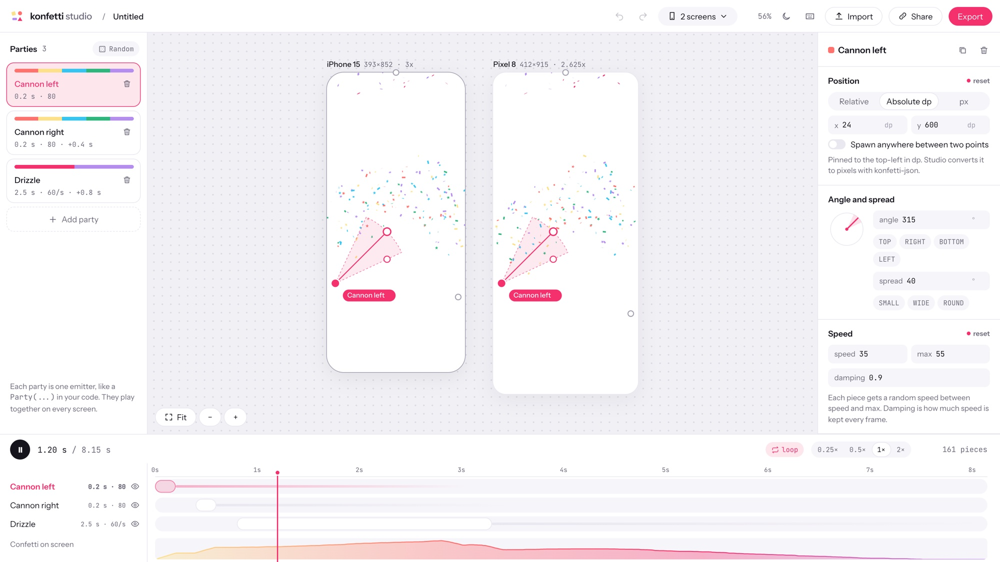

<p align="center">
  <picture>
    <source media="(prefers-color-scheme: dark)" srcset=".github/images/logo-dark.svg">
    
  </picture>
</p>

<p align="center">
  Celebrate little and big moments in your app with this lightweight confetti library.<br />
  Now on Android, iOS, desktop and the web.
</p>

<p align="center">
  <a href="https://opensource.org/licenses/ISC"></a>
  
  <a href="http://twitter.com/dionsegijn"></a>
  <a href="https://github.com/DanielMartinus/Konfetti/actions"></a>
</p>

<p align="center">
  <a href="https://danielmartinus.github.io/konfetti.studio/"></a>
  <a href="https://danielmartinus.github.io/Konfetti"></a>
</p>

<p align="center">
  <a href="https://danielmartinus.github.io/konfetti.studio/"></a>
</p>

<p align="center">
  <strong>Konfetti Studio</strong> lets you design a party visually, see it on real screen sizes and export it to each platform.
</p>

<p align="center">
  <a href="#getting-started">Getting started</a> •
  <a href="#usage">How To Use</a> •
  <a href="#migrating-from-2x">Migrating from 2.x</a> •
  <a href="#community">Community</a> •
  <a href="#contribute">Contribute</a> •
  <a href="#license">License</a>
</p>

> **3.0.0 is out!** Konfetti is now Kotlin Multiplatform. Most apps only need to bump the version, [see what changed](#migrating-from-2x).

## Getting started

Konfetti 3.0 works with Kotlin 2.2 and up, so also with the Kotlin that comes with AGP 9.

Compose Multiplatform (Android, iOS, desktop and web):
```kotlin
kotlin {
    sourceSets {
        commonMain.dependencies {
            implementation("nl.dionsegijn:konfetti-compose:3.0.0")
        }
    }
}
```

Android with Jetpack Compose (min API 23, compileSdk 35):
```kotlin
dependencies {
    implementation("nl.dionsegijn:konfetti-compose:3.0.0")
}
```

Android with views (XML, min API 15):
```kotlin
dependencies {
    implementation("nl.dionsegijn:konfetti-xml:3.0.0")
}
```

Both pull in `konfetti-core` automatically. Core is plain Kotlin Multiplatform without any UI, so you can also use it on its own to build your own renderer.

| Platform | Targets |
|---|---|
| Android | Compose and XML views |
| iOS | `iosArm64`, `iosSimulatorArm64` with Compose Multiplatform |
| Desktop | JVM with Compose for Desktop |
| Web | `wasmJs` and `js` with Compose Multiplatform |

Want to see it first? The [playground](https://danielmartinus.github.io/Konfetti) runs in your browser. Scrub through a party on the timeline, tweak it and copy the code.

Want to design your own? [Konfetti Studio](https://danielmartinus.github.io/konfetti.studio/) lets you build a party visually and export it to each platform.

Find latest version and release notes [here](https://github.com/DanielMartinus/Konfetti/releases)

## Usage

<p align="center">
  <strong>Samples:</strong></br>
  <a href="/samples/multiplatform">multiplatform</a> •
  <a href="/samples/playground/src/commonMain">playground</a> •
  <a href="/samples/compose-kotlin/src/main">compose</a> •
  <a href="/samples/xml-kotlin/src/main">xml-kotlin</a> •
  <a href="/samples/xml-java/src/main">xml-java</a> •
  <a href="/samples/shared/src/main/java/nl/dionsegijn/samples/shared/Presets.kt">presets</a>
</p>  

<p align="center">
  
</p>

Configure your confetti using the Party configuration object. This holds all the information on how the confetti will be generated.
Almost all properties of a Party object have a default configuration! This makes it super easy to create beautiful and natural looking confetti.


The bare minimum you need is an **Emitter** to tell how often and how many confetti should spawn, like this:
```kotlin
Party(
    emitter = Emitter(5.seconds).perSecond(30)
)
```

**But the possibilities are endless!** You can fully control how the confetti will be generated and behave by customizing the values of the Party object.
An example of a customized Party configuration is this:

```kotlin
Party(
    speed = 0f,
    maxSpeed = 30f,
    damping = 0.9f,
    spread = 360,
    colors = listOf(0xfce18a, 0xff726d, 0xf4306d, 0xb48def),
    position = Position.Relative(0.5, 0.3),
    emitter = Emitter(100.milliseconds).max(100)
)
```
_To learn more, see more samples linked at the top of [this section](#usage)_

### Party options

- `Angle` - **Int (default: 0)**: The direction the confetti will shoot. Use any integer between `0-360` or use presets like: Angle.TOP, Angle.RIGHT, Angle.BOTTOM, Angle.LEFT. Angle.RIGHT equates to `0` degrees, and larger values move clockwise from this position.
- `spread` - **Int (default: 360)**: How wide the confetti will shoot in the direction of Angle. Use any integer between `0-360`. Use 1 to shoot in a straight line and 360 to form a circle
- `speed` - **Float (default: 30f)**: The start speed of the confetti at the time of creation.
- `maxSpeed` - **Float (default: 0f)**: Set to -1 to disable maxSpeed. A random speed between `speed` and `maxSpeed` will be chosen. Using randomness creates a more natural and realistic look to the confetti when animating.)
- `damping` - **Float (default: 0.9f)**: The rate at which the speed will decrease right after shooting the confetti
- `size` - **`List<Size>` (default: SMALL, MEDIUM, LARGE)**: The size of the confetti. Use: Size.SMALL, MEDIUM or LARGE for default sizes or
 create your custom size using a new instance of `Size`.
- `colors` - **`List<Int>` (default: 0xfce18a, 0xff726d, 0xf4306d, 0xb48def)**: List of colors that will be randomly picked from
- `shapes` - **`List<Shape>` (default: Shape.Square, Shape.Circle)**: Also `Shape.Rectangle`, polygons like `Shape.Polygon.STAR` (see [Shapes](#shapes)) or your own image with `Shape.DrawableShape`
- `timeToLive` - **Long (default: 2000)**: The time in milliseconds a particle will stay alive after that the confetti will disappear.
- `fadeOutEnabled` - **Boolean (default: true)**: If true and a confetti disappears because it ran out of time (set with timeToLive) it will slowly fade out. If set to falls it will instantly disappear from the screen.
- `position` - **Position (default: Position.Relative(0.5, 0.5))**: the location where the confetti will spawn from relative to the canvas. Use absolute
 coordinates with `[Position.Absolute]` or relative coordinates between 0.0 and 1.0 using `[Position.Relative]`. Spawn confetti between random locations using `[Position.between]`.
 - `delay` - **Int (default: 0)**: the amount of milliseconds to wait before the rendering of the confetti starts
 - `rotation` - **Rotation (default: Rotation)**: enable the 3D rotation of a Confetti. See [Rotation] class for the configuration
 options. Easily enable or disable it using [Rotation].enabled() or [Rotation].disabled() and control the speed of rotations.
 - `emitter` - **EmitterConfig**: Instructions how many and how often a confetti particle should spawn. Use `Emitter(duration).max(amount)` or `Emitter(duration).perSecond(amount)` to configure the Emitter, for example `Emitter(5.seconds).perSecond(30)`. 

See Party implementation [here](/konfetti/core/src/commonMain/kotlin/nl/dionsegijn/konfetti/core/Party.kt)

### Shapes

Next to squares, circles and rectangles you can use polygons. They spin, flip and fade just like the other shapes. Three come built in:

```kotlin
shapes = listOf(Shape.Polygon.STAR, Shape.Polygon.TRIANGLE, Shape.Polygon.DIAMOND)
```

Want a different star? `Shape.Polygon.star(points = 6, innerRadius = 0.5f)` makes one with 6 points and wider arms.

You can also draw your own polygon. Each point is a fraction of the confetti's square, where (0, 0) is the top-left corner and (1, 1) the bottom-right one:

```kotlin
val arrow = Shape.Polygon(
    Shape.Polygon.Point(0.5f, 0f),
    Shape.Polygon.Point(1f, 0.6f),
    Shape.Polygon.Point(0.5f, 0.4f),
    Shape.Polygon.Point(0f, 0.6f),
)
```

Stars take a bit more work to draw than the other shapes, so for very big parties keep them in the mix rather than using only stars. The confetti's `Size` sets how big the square is, so a star might look better a size larger than your squares.

#### Your own image

Images work as confetti too. By default they get the confetti colors on top and fade out at the end. Turn that off to keep the image as it is.

With Compose, on every platform, use an `ImageBitmap` or a `Painter`, for example from Compose resources:

```kotlin
val heart = imageShape(painterResource(Res.drawable.heart))
val logo = imageShape(imageBitmap, tint = false)
```

On Android you can also use any drawable:

```kotlin
// Colored like the rest of the confetti
val heart = ImageUtil.loadDrawable(drawable)
// Original colors, still fades out
val logo = ImageUtil.loadDrawable(drawable, tint = false)
// Exactly as it is
val photo = ImageUtil.loadDrawable(drawable, tint = false, applyAlpha = false)
```

Then add it to the shapes of your party, for example `shapes = listOf(Shape.Square, logo)`.

### KonfettiView

Create a `KonfettiView` in your compose UI or add one to your xml layout depending on your setup.

Compose
```kotlin
val konfetti = rememberKonfettiState()

Button(onClick = { konfetti.start(party) }) {
    Text("Celebrate")
}

KonfettiView(
    state = konfetti,
    modifier = Modifier.fillMaxSize(),
)
```

`start` adds a party on top of whatever is already running, so you can call it as often as you like. Some other things you can do with the state:

```kotlin
konfetti.burst(at = offset, party = party) // start a party where the user tapped, in pixels
konfetti.stopGracefully()                  // stop spawning and let the confetti finish
konfetti.reset()                           // remove all confetti right away
```

Want to know when it's done? See [When a party ends](#when-a-party-ends).

If you only need confetti when a screen shows up, you can still pass the parties directly. `KonfettiView` starts over whenever the list changes, so `remember` your parties (and drawables) to avoid restarting on every recomposition:

```kotlin
val parties = remember { listOf(party) }
KonfettiView(modifier = Modifier.fillMaxSize(), parties = parties)
```

View-based (xml)
```xml
<nl.dionsegijn.konfetti.xml.KonfettiView
    android:id="@+id/konfettiView"
    android:layout_width="match_parent"
    android:layout_height="match_parent" />
```

```kotlin
Party(
    speed = 0f,
    maxSpeed = 30f,
    damping = 0.9f,
    spread = 360,
    colors = listOf(0xfce18a, 0xff726d, 0xf4306d, 0xb48def),
    emitter = Emitter(100.milliseconds).max(100),
    position = Position.Relative(0.5, 0.3)
)
viewKonfetti.start(party)
```

#### When a party ends

Want to hide the view or move on once the confetti is done? You get a call for every party that finishes, with the number of parties still running. When that's 0, everything is done.

```kotlin
// Compose
KonfettiView(
    state = konfetti,
    modifier = Modifier.fillMaxSize(),
    onPartyEnded = { activeParties ->
        if (activeParties == 0) showNextScreen()
    },
)

// View-based (xml)
konfettiView.onParticleSystemUpdateListener = object : OnParticleSystemUpdateListener {
    override fun onParticleSystemStarted(view: KonfettiView, party: Party, activeSystems: Int) {}

    override fun onParticleSystemEnded(view: KonfettiView, party: Party, activeSystems: Int) {
        if (activeSystems == 0) showNextScreen()
    }
}
```

#### In front of or behind other views

Konfetti draws in the order of your layout, like any other view or composable.

- In Compose, the composable that comes later in a `Box` draws on top. Put `KonfettiView` last to show confetti in front of everything, or first to keep it behind. `Modifier.zIndex()` changes the order without moving code around.
- In XML, a view later in the layout draws on top. Views with elevation, like buttons and cards, always draw above views without it, no matter where they are in the layout. To get confetti in front of those too, give the `KonfettiView` a higher `android:elevation` or `android:translationZ`.

#### Remove animations

Some people turn on "Remove animations" (Android) or "Reduce Motion" (iOS and the browser) in their settings, for example because motion makes them feel sick. Konfetti doesn't change anything by itself, but you can check the setting and skip the confetti or show something calmer instead:

```kotlin
// Compose, on desktop this is always false
val reduceMotion = rememberReduceMotion()
Button(onClick = { if (!reduceMotion) konfetti.start(party) }) { Text("Celebrate") }

// View-based (xml)
if (!KonfettiView.isReduceMotionEnabled(context)) konfettiView.start(party)
```

And that's it! There are endless possibilities to configure the confetti. If you want to learn more on how to implement Konfetti in a java, xml or compose project then see the samples linked at the top of [this section](#usage)

## Migrating from 2.x

Most apps only need to bump the version. Party, Position, Shape and the rest of the API work as before. These are the things that did change:

- **Compose Multiplatform.** `konfetti-compose` is built with Compose Multiplatform 1.11. On Android that means min API 23 (was 21) and compileSdk 35 or higher.
- **Emitter takes a Duration.** Write `Emitter(5.seconds)` or `Emitter(5, DurationUnit.SECONDS)`. In Kotlin on Android and the JVM, `Emitter(5, TimeUnit.SECONDS)` still works. From Java, use `new Emitter(5L, DurationUnit.SECONDS)`. `Emitter.timeUnit` is now a `DurationUnit`.
- **Smoother on fast screens.** Confetti now moves by time instead of by frame. On 60 Hz screens it looks the same as before. On 90 and 120 Hz screens it now looks the same as on 60 Hz, where before it fell and slowed down at a different pace.
- **kotlin.random.** If you built your own renderer on `konfetti-core`, `PartySystem` and `PartyEmitter` now take a `kotlin.random.Random` instead of a `java.util.Random`.

`konfetti-xml` and `konfetti-image` stay Android only and still support API 15.

Coming from 1.x? See the [2.0 migration guide](https://dionsegijn.dev/konfetti-migration-guide-v2.x.x) first.

## Community

- Follow me on twitter for updates [here](https://twitter.com/dionsegijn)
- Do you have any questions or need help implementing this library? Search if your question is already asked [here](https://github.com/DanielMartinus/Konfetti/issues?q=is%3Aissue)
- Or join our telegram chat group and maybe someone can help you out [here](https://t.me/konfetti_chat) 

## Contribute

Do you see any improvements or want to implement a missing feature? Contributions are very welcome!
- Is your contribution relatively small? You can, make your changes, run the code checks, open a PR and make sure the CI is green. That's it! 
- Are the changes big and do they make a lot of impact? Please open an issue [here](https://github.com/DanielMartinus/Konfetti/issues?q=is%3Aissue) or reach out and let's discuss.

Take into account that changes and requests can be rejected if they don't align with the **purpose of the library**. To not waste any time you can always open an issue [here](https://github.com/DanielMartinus/Konfetti/issues?q=is%3Aissue) to talk before you start making any changes.

### What is the purpose of this library?
To have a lightweight particle system to easily generate confetti particles to celebrate little and big moments. Even though this is a particle system the purpose is not to be a fully fledged particle system. Changes and features are meant to be in line with being a confetti library. A great example is the implementation of custom shapes by @mattprecious [here](https://github.com/DanielMartinus/Konfetti/pull/129).

## Report an issue

- Did you find an issue and want to fix it yourself? See [Contribute](#contribute) for more information
- Want to report an issue? You can do that [here](https://github.com/DanielMartinus/Konfetti/issues?q=is%3Aissue). By adding as much details when reporting the issue and steps to reproduce you improve the change it will be solved quickly. 

## License

Konfetti is released under the ISC license. See [LICENSE](https://github.com/DanielMartinus/Konfetti/blob/main/LICENSE) for details.
