<p align="center">
  <picture>
    <source media="(prefers-color-scheme: dark)" srcset=".github/readme/hero-dark.svg">
    
  </picture>
</p>

<h3 align="center">Celebrate the little and big moments in your app.</h3>

<p align="center">
  A lightweight confetti library for Kotlin Multiplatform.<br>
  One <code>Party</code>, on Android, iOS, desktop and the web.
</p>

<p align="center">
  <a href="https://central.sonatype.com/artifact/nl.dionsegijn/konfetti-compose"></a>
  <a href="https://github.com/DanielMartinus/Konfetti/actions"></a>
  <a href="LICENSE"></a>
</p>

<p align="center">
  <a href="#get-started"><b>Get started</b></a>
  &nbsp;·&nbsp;
  <a href="#konfetti-studio"><b>Konfetti Studio</b></a>
  &nbsp;·&nbsp;
  <a href="https://danielmartinus.github.io/Konfetti"><b>Playground</b></a>
  &nbsp;·&nbsp;
  <a href="docs/guide.md"><b>Guide</b></a>
  &nbsp;·&nbsp;
  <a href="#migrating-from-2x"><b>Migrating from 2.x</b></a>
</p>

<br>

## Get started

```kotlin
// Compose Multiplatform, or Android with Jetpack Compose
commonMain.dependencies {
    implementation("nl.dionsegijn:konfetti-compose:3.0.0")
}

// Android with views (XML)
dependencies {
    implementation("nl.dionsegijn:konfetti-xml:3.0.0")
}
```

Put a `KonfettiView` over your screen and start a party:

```kotlin
val konfetti = rememberKonfettiState()

Box {
    Button(onClick = { konfetti.start(Party(emitter = Emitter(100.milliseconds).max(100))) }) {
        Text("Celebrate")
    }
    KonfettiView(state = konfetti, modifier = Modifier.fillMaxSize())
}
```

That's it. `start` adds a party on top of whatever is already running, so call it as often as you like.

<details>
<summary><b>With XML views</b></summary>
<br>

```xml
<nl.dionsegijn.konfetti.xml.KonfettiView
    android:id="@+id/konfettiView"
    android:layout_width="match_parent"
    android:layout_height="match_parent" />
```

```kotlin
konfettiView.start(Party(emitter = Emitter(100.milliseconds).max(100)))
```

From Java, see the [xml-java sample](samples/xml-java/src/main).
</details>

| Platform | Targets | Needs |
|---|---|---|
| Android | Compose and XML views | Compose: min API 23, compileSdk 35 · XML: min API 15 |
| iOS | `iosArm64`, `iosSimulatorArm64` | Compose Multiplatform |
| Desktop | JVM | Compose for Desktop |
| Web | `wasmJs` and `js` | Compose Multiplatform, Kotlin 2.4 |

Konfetti works with Kotlin 2.2 and up, so also with the Kotlin that comes with AGP 9. `konfetti-core` has no UI at all, if you'd rather build your own renderer.

## Make it yours

<p align="center">
  <picture>
    <source media="(prefers-color-scheme: dark)" srcset=".github/readme/presets-dark.svg">
    
  </picture>
</p>

Every one of these is a `Party`. Almost everything has a default, so you only set what you want to change. This is Explode:

```kotlin
Party(
    speed = 0f,
    maxSpeed = 30f,
    damping = 0.9f,
    spread = 360,
    colors = listOf(0xfce18a, 0xff726d, 0xf4306d, 0xb48def),
    position = Position.Relative(0.5, 0.3),
    emitter = Emitter(100.milliseconds).max(100),
)
```

The other three are in [Presets.kt](samples/shared/src/main/java/nl/dionsegijn/samples/shared/Presets.kt). And there's more to play with:

- **[Shapes](docs/guide.md#shapes)**: squares, circles, rectangles, stars, or any polygon you draw
- **[Streamers](docs/guide.md#streamers)**: curly paper ribbons that hang from their head and spin as they fall
- **[Images](docs/guide.md#your-own-image)**: your own drawable, `Painter` or `ImageBitmap` as confetti
- **[Drift](docs/guide.md#party-options)**: confetti that sways from side to side while it falls, like paper
- **[Bursts](docs/guide.md#konfettiview)**: start a party right where the user tapped
- **[Reduce motion](docs/guide.md#remove-animations)**: check the system setting and keep things calm

Every option is in the **[guide](docs/guide.md)**.

## Konfetti Studio

<p align="center">
  <a href="https://danielmartinus.github.io/konfetti.studio/">
    
  </a>
</p>

Design your confetti on a stage instead of in code. Drag an emitter where you want it, aim it, and watch it play on phones, tablets and the web side by side, at their real size. Scrub through it on the timeline, then export it as Kotlin, or as a json file your app plays as is:

```kotlin
implementation("nl.dionsegijn:konfetti-json:3.0.0")

val parties = KonfettiJson.decode(json, density = LocalDensity.current.density)
konfetti.start(parties)
```

What you see is what your app shows: Studio plays your parties with Konfetti itself.

<p align="center">
  <a href="https://danielmartinus.github.io/konfetti.studio/"></a>
</p>

## Migrating from 2.x

For most Kotlin apps that use `Party` and `KonfettiView`, bumping the version is enough. Compose now needs min API 23 and compileSdk 35, `Emitter` takes a `Duration`, and confetti moves by time, so it looks the same at 60 and 120 Hz. Everything that changed is in the **[migration guide](docs/migrating-to-3.md)**.

Find the latest version and release notes in [Releases](https://github.com/DanielMartinus/Konfetti/releases).

## Community

Questions or stuck on something? Search the [issues](https://github.com/DanielMartinus/Konfetti/issues?q=is%3Aissue) or open a new one. Follow [@dionsegijn](https://twitter.com/dionsegijn) for updates.

Contributions are very welcome. Small change? Make it, run the code checks and open a PR with a green CI. Something bigger? [Open an issue](https://github.com/DanielMartinus/Konfetti/issues) first so we can talk it through.

Konfetti is a lightweight particle system for confetti, not a fully fledged particle system. Changes are meant to fit a confetti library, like the custom shapes by @mattprecious in [#129](https://github.com/DanielMartinus/Konfetti/pull/129).

<br>

<p align="center">
  
  <br>
  <sub>Released under the <a href="LICENSE">ISC license</a> · Instrument Sans is SIL OFL</sub>
</p>
